# Архитектура системы

> Фича: 000-architecture
> Спецификация: ./spec.md · План: ./plan.md

Схемы в Mermaid — Obsidian рендерит их в режиме чтения.

## 1. Контекст (C4, уровень 1)

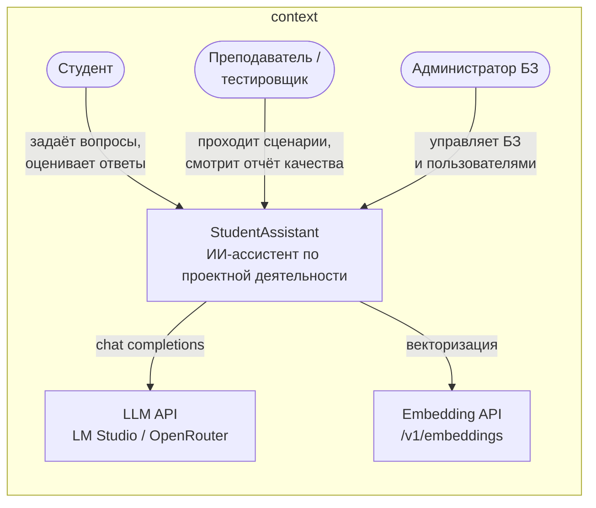

Внешние зависимости: **LLM API**, **Embedding API** (в dev — LM Studio, в prod —
внешние провайдеры) и **корпус БЗ** (файлы, которые загружает администратор).
Сервис не держит модели в памяти: на VPS только приложение, PostgreSQL и Qdrant.

## 2. Контейнеры (C4, уровень 2)

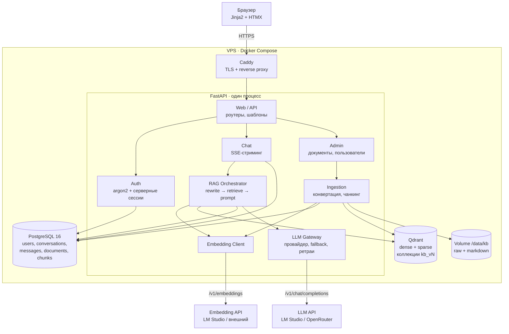

**Почему один процесс:** микросервисы здесь не окупаются — команда из двух
разработчиков, нагрузка бытовая. Модели вынесены за API, поэтому приложение
остаётся лёгким и может жить на дешёвом VPS. Если индексация станет тяжёлой,
её вынесение в отдельный воркер не потребует менять контракты.

## 3. Основной сценарий: вопрос → ответ

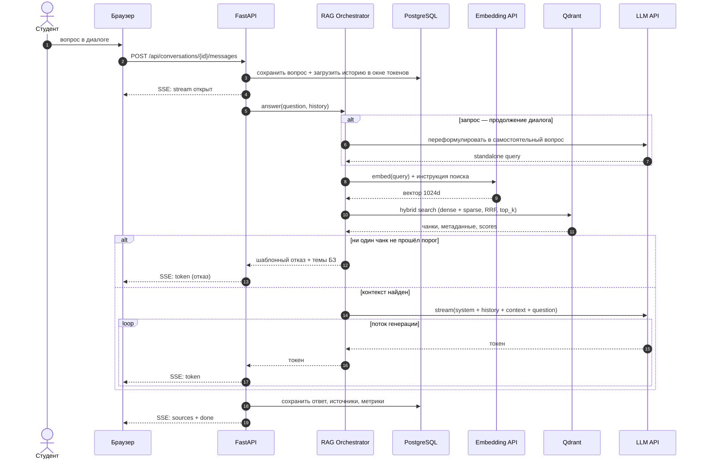

**Ключевое решение:** сначала сохраняем вопрос, потом генерируем. Если LLM упал или
клиент отвалился — вопрос и частичный ответ не теряются.

**Окно контекста** задаётся бюджетом токенов модели, а не фиксированным числом
сообщений: история подбирается с конца, пока помещается в лимит. Старые сообщения
остаются в БД и видны в UI, но в промпт не попадают.

## 4. Аутентификация и администрирование

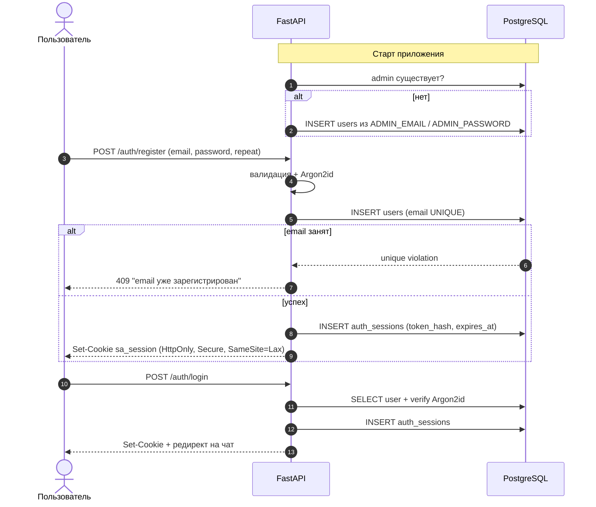

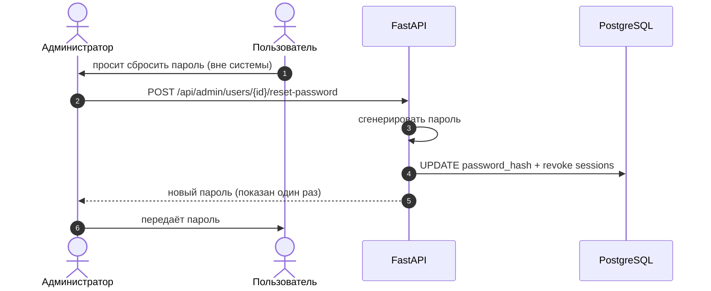

Сессии серверные: в cookie — токен, в БД — его хеш. Сброс пароля отзывает все
сессии пользователя. Пароль никогда не пишется в логи.

## 5. Пайплайн базы знаний

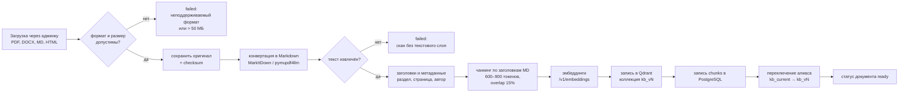

**Markdown как канонический формат.** Конвертация происходит один раз при загрузке.
Дальше и чанкинг, и цитаты, и просмотр фрагмента работают с одним представлением —
не нужно поддерживать отдельные ветки для PDF, DOCX и HTML.

**Blue/green индексация:** новая версия собирается в отдельной коллекции, поиск до
последнего момента идёт по старой. Переключение алиаса атомарно, откат — вернуть
алиас на предыдущую коллекцию.

**Хранение файлов:** `/data/kb/raw/{document_id}.{ext}` — оригинал,
`/data/kb/md/{document_id}.md` — результат конвертации. В git не попадает ничего,
кроме манифеста и кода.

## 6. Состояния документа

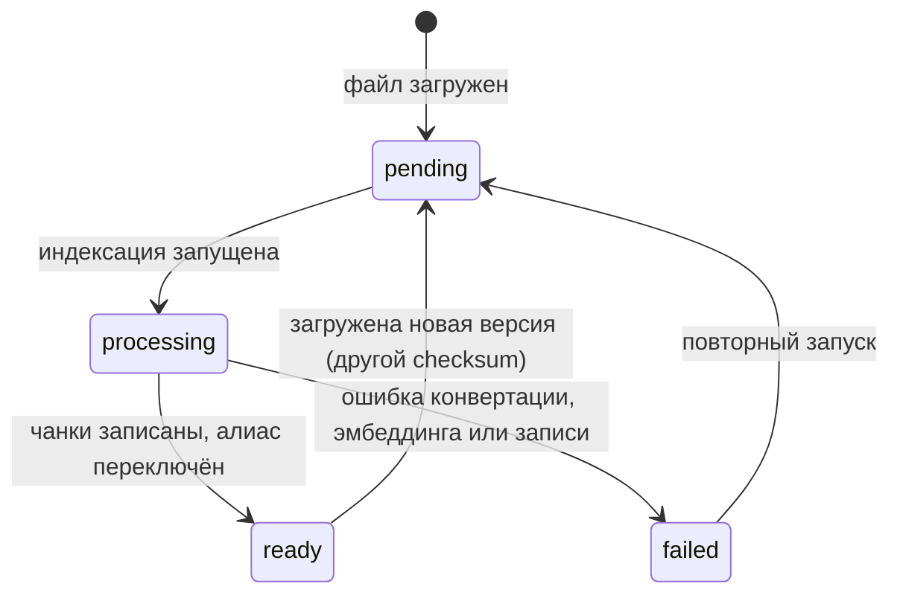

## 7. Развёртывание

**Разработка (localhost):**

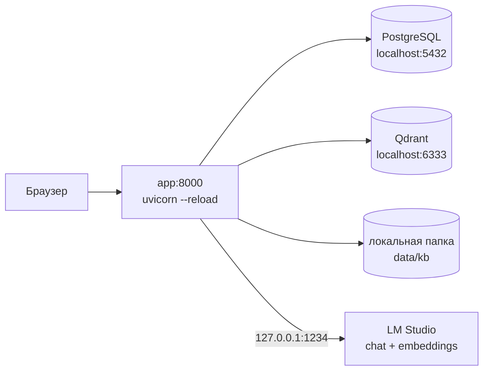

**Продакшен (VPS):**

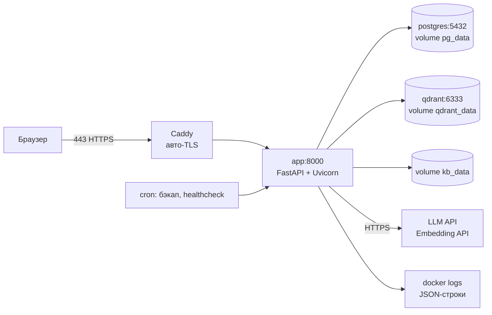

На VPS живут только приложение и БД. Модели — за API, поэтому серверу не нужен GPU
и большой объём RAM.

## 8. Режимы LLM и эмбеддингов

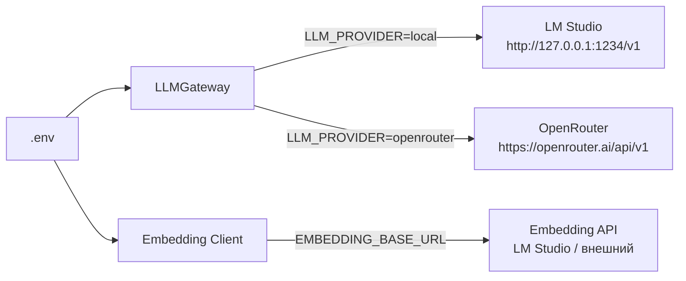

| Режим | Когда используем | Плюсы | Ограничения |
|-------|------------------|-------|-------------|
| local (LM Studio) | разработка, eval, демо без интернета | 0 ₽, нет лимитов, данные не уходят | нужен мощный ПК, качество зависит от модели |
| remote (OpenRouter) | прод на VPS, приёмка | не грузит сервер, сильные модели | лимиты free-моделей, нужен интернет |

Контракт в обоих случаях одинаковый — OpenAI-совместимые `/v1/chat/completions` и
`/v1/embeddings`. Меняются только `LLM_BASE_URL`, `LLM_API_KEY`, `LLM_MODEL`,
`EMBEDDING_BASE_URL`; код и пайплайн те же.

**Подводный камень с адресом.** `127.0.0.1` внутри контейнера — это сам контейнер, а
не хост. Если приложение запущено в Docker:

- Docker Desktop (Windows/macOS) — `http://host.docker.internal:1234/v1`;
- Linux, bridge-сеть — `http://172.17.0.1:1234/v1` (либо `network_mode: host`);
- запуск без Docker — `http://127.0.0.1:1234/v1`.

Это фиксируется в `.env.example` и в README, иначе первый запуск local-режима
упирается в «connection refused».

**Открытый вопрос:** OpenRouter не предоставляет embeddings. Для продакшена нужен
отдельный провайдер эмбеддингов — LM Studio на отдельном хосте, Jina/Cohere или
GigaChat embeddings. Интерфейс уже универсальный, решение не блокирует разработку.

## 9. Карта компонентов и спецификаций

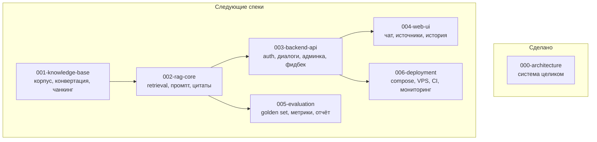

Порядок неслучаен: **качество RAG проверяется до того, как появится красивый UI.**
Если retrieval плохой, никакой интерфейс это не спасёт.
